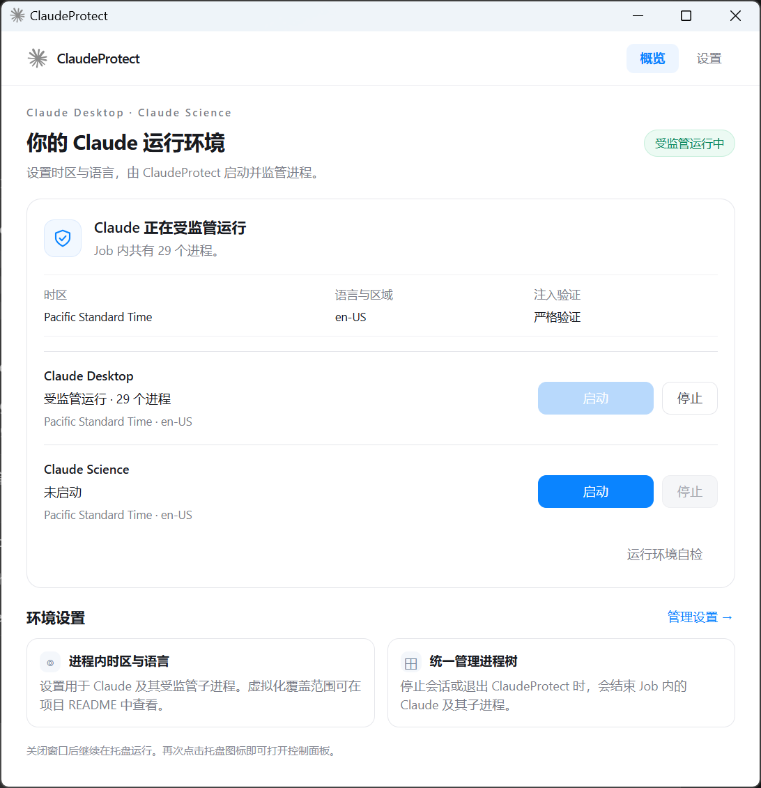

# ClaudeProtect

> macOS：Apple Silicon 适配与独立 DMG 打包说明见 [macOS 使用说明](macos/README.md)。

Windows x64 托盘应用，在指定时区和语言环境下启动并监管 Claude Desktop 与 Claude Science。

## 核心功能

- **一个实例管理两个应用** — Desktop 与 Science 可同时运行，各自启动、停止并显示状态。
- **进程内时区与语言** — 配置时区、区域、代码页和首选语言，默认洛杉矶时区与美式英语，支持夏令时。宿主 Windows 设置保持原样。
- **独立进程树监管** — 每个应用使用独立 Job。停止应用或主进程退出时清理对应进程树，退出 ClaudeProtect 时清理全部受监管进程。
- **启动预检与严格验证** — 启动前检查虚拟环境，运行中检查 LEP 注入证据，严格模式检测失败时停止对应会话。
- **自动发现与托盘控制** — 自动查找应用安装路径，通过中文设置面板配置。关闭面板后继续在托盘运行。



## 快速开始

运行需要 Windows 10/11 x64 和 Microsoft Edge WebView2 Evergreen Runtime。

1. 退出准备监管的 Desktop 或 Science，包括其后台进程。
2. 运行 `build\ClaudeProtect.exe`，在 **设置** 中选择时区、语言和保护策略并保存。
3. 在概览页对应应用一行点击 **启动**，可分别启动两个应用。
4. 点击对应的 **停止** 结束会话，或从托盘退出 ClaudeProtect。

两个应用共用时区、语言和保护策略，启动器路径分别配置，留空时自动发现。配置保存在 EXE 旁的 `ClaudeProtect.ini`，修改在下次启动会话时生效。运行目录需要当前用户具有写入权限。

Science 使用默认桌面启动交接，附加参数需留空。已验证的范围与当前限制见[Science 验证记录](docs/claude-science-2026-11-11.md)。

## 从源码构建

准备 MinGW-w64 x64 `g++`、`windres`、PowerShell 7、Python 3.10+、MSVC C++ 工具链及 Windows SDK。将 `git`、`g++`、`windres`、`pwsh` 和 `python` 加入 `PATH`。

```powershell
git submodule update --init --recursive
pwsh -NoProfile -File scripts/build.ps1 -BuildLep
```

构建结果位于 `build/`。首次构建会下载并校验固定版本的 WebView2 SDK，界面资源嵌入 EXE。

开发、测试及清理流程见[贡献指南](CONTRIBUTING.md)，LEP 集成方式见[补丁文档](patches/lep/README.md)。

## 许可证与致谢

ClaudeProtect 自有代码采用 **GPL-3.0-only**。[完整许可证](LICENSE)

进程内虚拟化由 LocaleEmulatorPlus-Core 提供，源自 Locale Emulator。第三方许可与声明见[依赖说明](THIRD_PARTY_NOTICES.md)。[LocaleEmulatorPlus-Core](https://github.com/julixian/LocaleEmulatorPlus-Core) · [Locale Emulator](https://github.com/xupefei/Locale-Emulator)

本项目由社区独立开发。Claude、Claude Desktop 和 Claude Science 的相关商标归其各自权利人所有。
